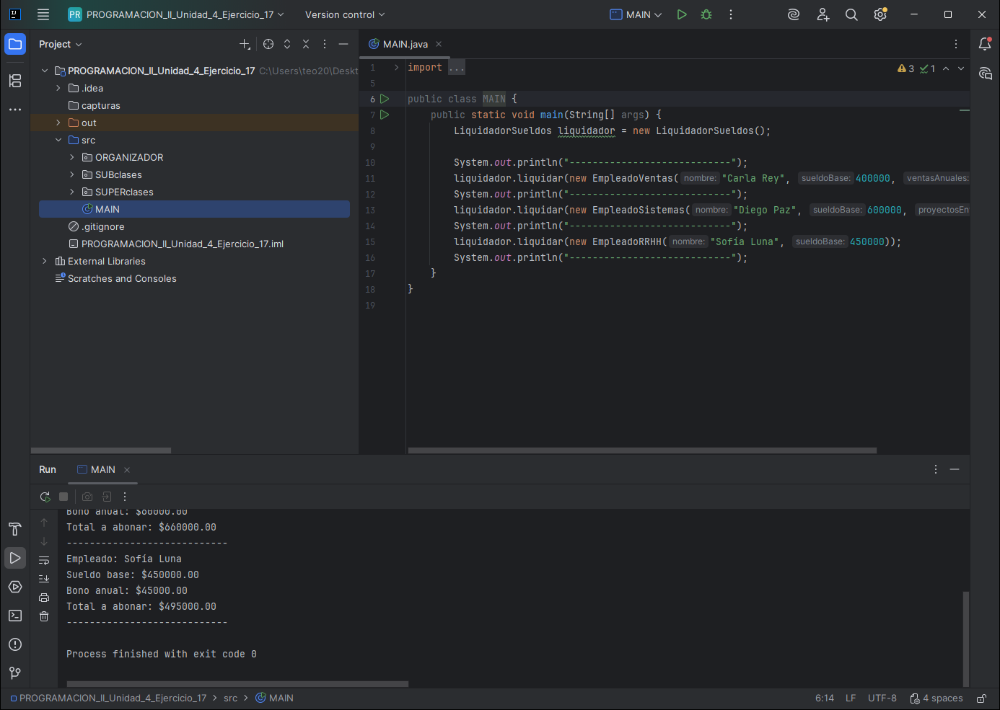

# PROGRAMACIÓN II — Unidad 4, Ejercicio 17: El Sistema de Bonificaciones Salariales por Desempeño

Trabajo práctico de Programación II. Este repositorio contiene la resolución en Java del ejercicio 17 de la Unidad 4.

## Consigna

#### Contexto

Una corporación multinacional calcula los bonos de fin de año para sus trabajadores basándose en el sector operativo al que pertenecen (personal de ventas, personal de sistemas y personal de recursos humanos). El sistema de recursos humanos liquida las primas de forma polimórfica, delegando en el objeto empleado la responsabilidad de calcular el monto correspondiente.

#### Consigna

Construir un modelo orientado a objetos en Java que aplique polimorfismo para calcular la compensación anual de un trabajador según su rol dinámico en la empresa.

#### Desarrollo requerido

- Crear una clase abstracta TrabajadorCorporativo comúnmente provista de atributos como nombre y sueldoBase, incorporando el método abstracto double calcularBonoAnual().
- Desarrollar clases hijas como EmpleadoVentas, EmpleadoSistemas y EmpleadoRRHH que sobrescriban el cálculo aplicando porcentajes de comisiones o premios por objetivos diferenciales.
- Crear una clase LiquidadorSueldos que reciba una referencia de tipo TrabajadorCorporativo para procesar el total a abonar sin verificar explícitamente la subclase mediante condicionales.
- En el método main, instanciar distintos perfiles de empleados, realizar simulaciones de liquidación y mostrar el desglose de los montos finales por consola.

## Estructura del repositorio

```
PROGRAMACION_II_Unidad_4_Ejercicio_17/
├── README.md
├── capturas/
│   └── consola.png
└── src/
    ├── ORGANIZADOR/
    │   └── LiquidadorSueldos.java
    ├── SUBclases/
    │   ├── EmpleadoRRHH.java
    │   ├── EmpleadoSistemas.java
    │   └── EmpleadoVentas.java
    ├── SUPERclases/
    │   └── TrabajadorCorporativo.java
    └── MAIN.java   # clase con el método main
```

## Funcionamiento y lógica

El ejercicio aplica **polimorfismo** para liquidar sueldos con bonos anuales que se calculan distinto según el área del empleado. Está organizado en los paquetes `SUPERclases`, `SUBclases` y `ORGANIZADOR`.

### `SUPERclases.TrabajadorCorporativo` (clase abstracta)

Tiene `nombre` y `sueldoBase` (privados, con getters) y el método abstracto `calcularBonoAnual()`.

### `SUBclases`

- **`EmpleadoVentas`:** el bono es el 3 % de sus ventas anuales.
- **`EmpleadoSistemas`:** el bono es $15000 por cada proyecto entregado.
- **`EmpleadoRRHH`:** el bono es el 10 % de su sueldo base.

### `ORGANIZADOR.LiquidadorSueldos`

Su método `liquidar(trabajador)` le pide el bono a cualquier tipo de empleado, lo suma al sueldo base y muestra el detalle con dos decimales. Además devuelve el total.

### `MAIN`

Liquida los sueldos de tres empleados:

| Empleado | Sueldo base | Bono | Total |
|---|---|---|---|
| Carla Rey (ventas, $5000000 vendidos) | $400000 | $150000 | **$550000** |
| Diego Paz (sistemas, 4 proyectos) | $600000 | $60000 | **$660000** |
| Sofía Luna (RR. HH.) | $450000 | $45000 | **$495000** |

## Ejecución

Captura de la consola de IntelliJ IDEA ejecutando el programa:



Salida obtenida:

```
----------------------------
Empleado: Carla Rey
Sueldo base: $400000.00
Bono anual: $150000.00
Total a abonar: $550000.00
----------------------------
Empleado: Diego Paz
Sueldo base: $600000.00
Bono anual: $60000.00
Total a abonar: $660000.00
----------------------------
Empleado: Sofía Luna
Sueldo base: $450000.00
Bono anual: $45000.00
Total a abonar: $495000.00
----------------------------
```
